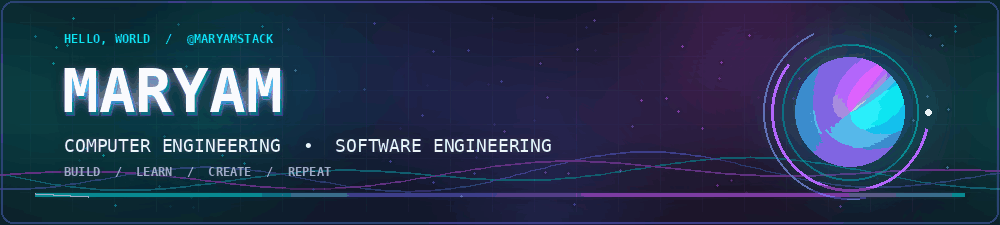

[Uploading README.md…]()
<!--
  Profile README for @maryamstack
  Replace YOUR_LINKEDIN_URL and YOUR_LEETCODE_URL with your real profile URLs.
  The contribution snake is generated by .github/workflows/snake.yml.
-->

  <!-- Seamless prismatic GIF: 72 frames, periodic motion, infinite loop -->
  

  

  

    
    
    
  

  <h3>Curiosity sparks ideas. Consistency turns them into engineering.</h3>

  

## 👩‍💻 About Me

I'm **Maryam**, an undergraduate **Computer Engineering** student interested in software engineering, thoughtful problem-solving, and the technologies shaping the future.

I enjoy turning ideas into practical interfaces and understanding how software is designed from the ground up. My strongest current foundation is in **HTML, CSS, and web template design**. I have also studied and practiced **Dart**, explored **Python**, and am currently completing the fundamentals of **JavaScript**.

I see software development as a long-term engineering journey: master the fundamentals, build useful things, understand the systems behind them, and keep improving through deliberate practice. My long-term ambition is to grow into a versatile software engineer and eventually specialize in **Artificial Intelligence Engineering**.

| | Profile snapshot |
|:--|:--|
| 🎓 **Education** | Undergraduate Computer Engineering student |
| 🎨 **Current strengths** | HTML, CSS, web layout and template design |
| 🌱 **Current focus** | Completing JavaScript fundamentals |
| 🧩 **Previous learning** | Dart practice and Python fundamentals |
| 🧠 **Interests** | Software engineering, algorithms, problem-solving and AI |
| 🎯 **Long-term direction** | Full-stack development followed by AI and machine learning |

---

## 🧰 Technology & Skills

  <h4>Web Foundations</h4>
  
  
My current strengths: semantic page structure, styling, layouts and web template design.

  <h4>Programming Languages</h4>
  

  <h4>Tools & Workflow</h4>
  

| Technology | Current stage | Experience |
|:--|:--|:--|
| **HTML5** | Comfortable | Page structure and web templates |
| **CSS3** | Comfortable | Styling, layouts and template design |
| **JavaScript** | Currently learning | Completing the fundamentals before moving to advanced JavaScript |
| **Dart** | Previously studied and practiced | Completed exercises and kept practice work in GitHub repositories |
| **Python** | Previously studied | Earlier learning experience; plan to build on it later |

*The icons show technologies I have worked with or plan to explore. The table clarifies my current experience level.*

---

## 🗺️ Learning Roadmap

My roadmap is intentionally progressive: deepen the foundations first, then expand into frontend, backend, mobile development and AI.

| Stage | Planned focus | Objective |
|:--:|:--|:--|
| **01 · Now** | Advanced JavaScript | Strengthen core language concepts and write maintainable code |
| **02** | React.js → Next.js | Build modern, component-based web applications |
| **03** | Node.js | Learn server-side JavaScript and backend development |
| **04** | Flutter | Explore cross-platform mobile development |
| **05** | Databases → Django | Learn data modelling, SQL and Python-based backend development |
| **06 · Long-term** | Artificial Intelligence | Build foundations in machine learning and AI engineering |

  
   
  Roadmap technologies — learning goals, not a claim of current proficiency.

---

## 📂 Projects & Practice

I use GitHub to document my learning, keep programming exercises organized, and build practical projects over time. My public repositories include **Dart practice and exercises**, alongside ongoing learning work.

  

> As my portfolio grows, this section will highlight selected projects with concise descriptions, technology choices and direct source-code links.

---

## 📊 GitHub Analytics

  
  

   

  

### 📈 Contribution Activity

  

### 🐍 Contribution Snake

  <picture>
    <source media="(prefers-color-scheme: dark)" srcset="https://raw.githubusercontent.com/maryamstack/maryamstack/output/github-snake-dark.svg" />
    <source media="(prefers-color-scheme: light)" srcset="https://raw.githubusercontent.com/maryamstack/maryamstack/output/github-snake.svg" />
    
  </picture>

---

## 🤝 Let's Connect

I'm always glad to connect with developers, learn from the community, and exchange ideas about software engineering and emerging technologies.

  
  
  

---

  <h3>✨ A Principle I Believe In</h3>

  **Learn deeply. Build consistently. Think critically. Engineer responsibly.**

  Thanks for visiting — feel free to explore my repositories.

  

